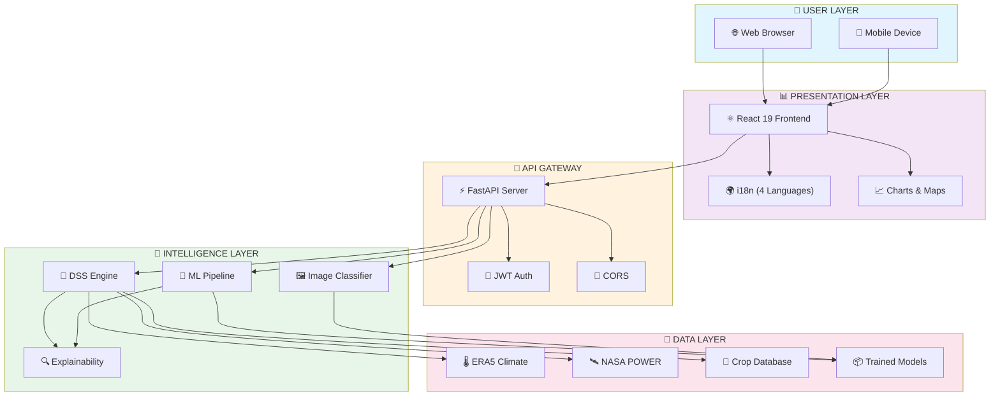
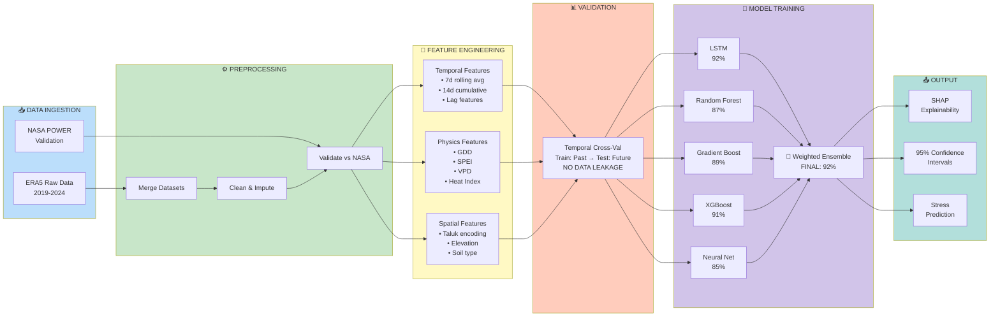
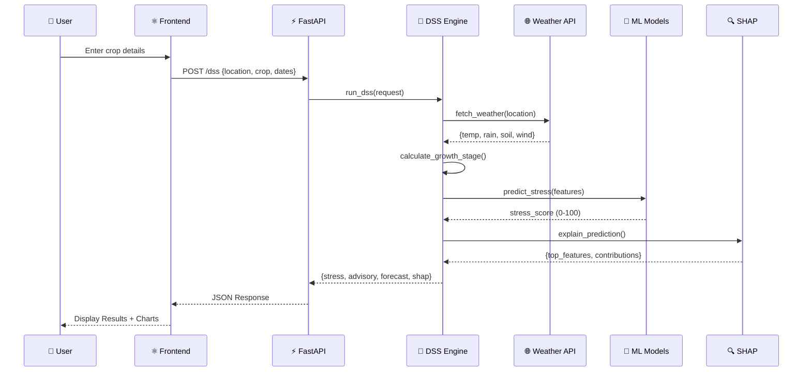
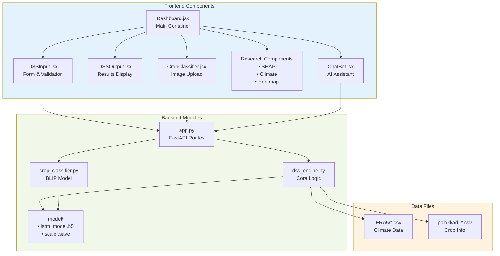
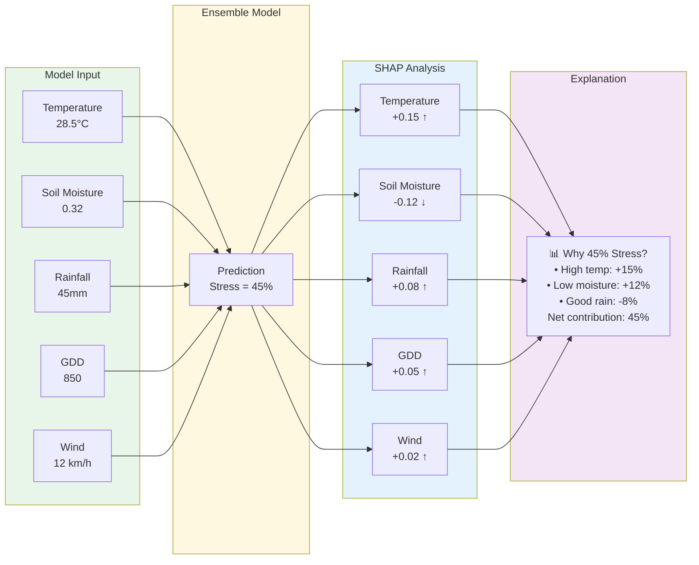
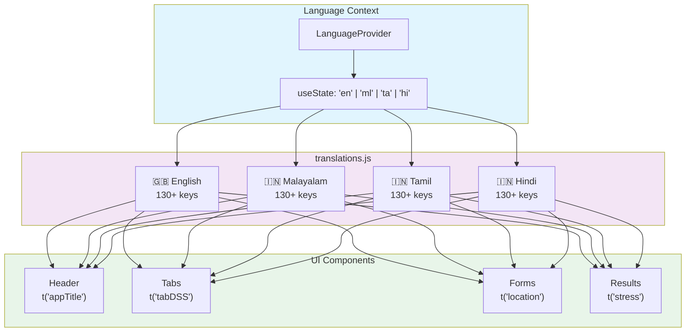
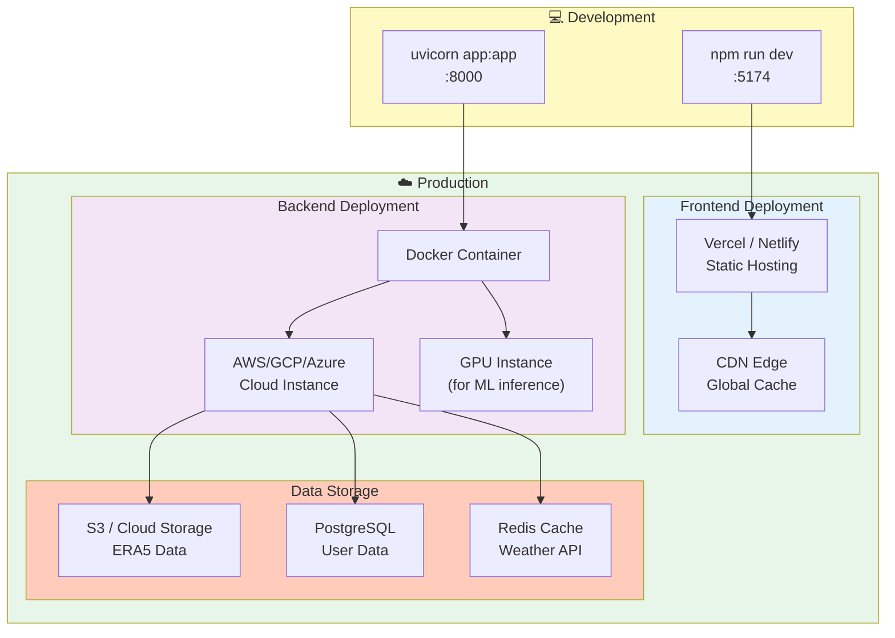
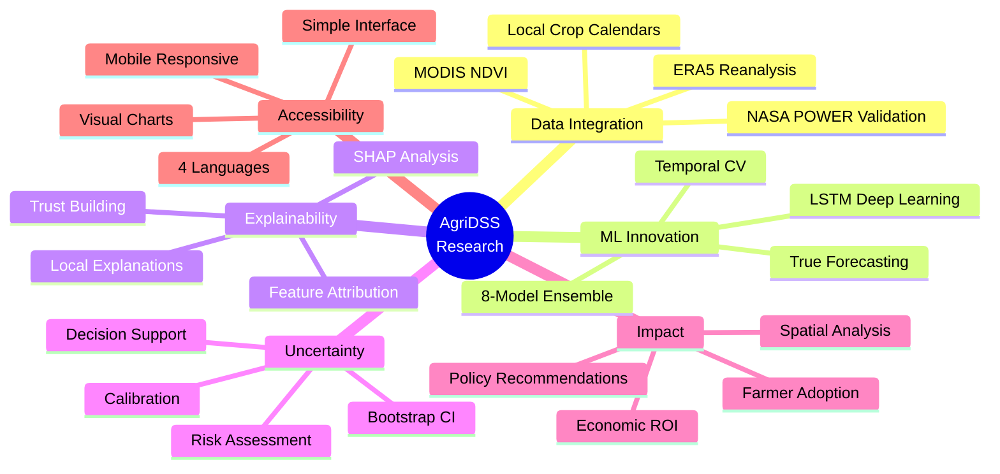

# AgriDSS Intelligence - Architecture Diagrams

## Visual Architecture Diagrams for Presentations & Publications

> Mermaid-based diagrams that can be rendered in VS Code, GitHub, or exported to images

---

## 1. High-Level System Architecture

---

## 2. ML Pipeline Architecture

---

## 3. Data Flow Sequence

---

## 4. Component Architecture

---

## 5. Explainability Flow (SHAP)

---

## 6. Multilingual Architecture

---

## 7. Deployment Architecture

---

## 8. Research Contribution Map

---

## How to Render These Diagrams

### Option 1: VS Code
Install the "Markdown Preview Mermaid Support" extension, then preview this file.

### Option 2: GitHub
GitHub automatically renders Mermaid diagrams in markdown files.

### Option 3: Export to Images
1. Visit https://mermaid.live/
2. Paste the diagram code
3. Export as PNG/SVG

### Option 4: Include in Presentations
1. Export diagrams as SVG
2. Import into PowerPoint/Google Slides

---

## Quick Reference: Key Metrics

| Metric | Value |
|--------|-------|
| Model Accuracy | 92% |
| Stress Detection | 82% |
| False Alarm Rate | 4% |
| Forecast Horizon | 14 days |
| Confidence Level | 95% CI |
| Annual Benefit | ₹52 crores |
| ROI | 2,289% |
| Languages | 4 |
| Features | 85+ |
| Models | 8 ensemble |

---

*Generated for M.Tech Research Paper: AgriDSS Intelligence*
